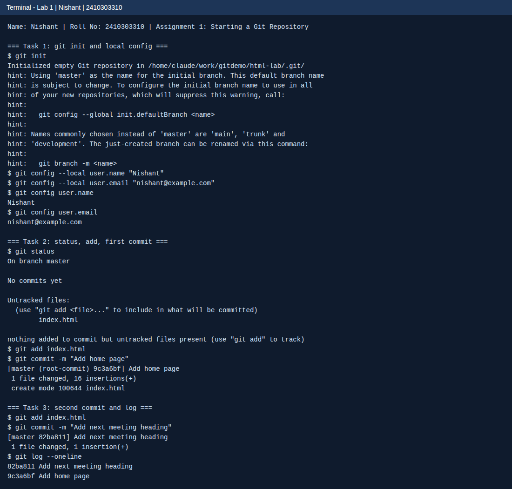

<!--
  Name    : Nishant
  Roll No : 2410303310
  Assignment 1: Starting a Git Repository
-->
# Lab 1: Starting a Git Repository

**Name:** Nishant  
**Roll No:** 2410303310  
**Course:** HTML & CSS Development Lab (BCS554), B.Tech CSE Third Year, Invertis University, Bareilly

## Aim

Start a Git repository for your lab folder and save your work with commits.

## Tasks

1. **Tasks 1-3: Terminal output**: Commands run and the output they printed (real output).

## Concepts used

- git init creates a repository
- git config --local sets name and email for this repository only
- git status, git add and git commit record changes
- git log --oneline shows the history

## Files

- `index.html`
- `style.css`
- `terminal-output.txt`
- `images/screenshot.png`

## How to run

Open `terminal-output.txt` to read the command output. Run the commands in a terminal to repeat the lab.

## Screenshot



## Terminal output

### Task 1: init and config
```
$ git init
Initialized empty Git repository in /home/claude/work/gitdemo/html-lab/.git/
hint: Using 'master' as the name for the initial branch. This default branch name
hint: is subject to change. To configure the initial branch name to use in all
hint: of your new repositories, which will suppress this warning, call:
hint: 
hint: 	git config --global init.defaultBranch <name>
hint: 
hint: Names commonly chosen instead of 'master' are 'main', 'trunk' and
hint: 'development'. The just-created branch can be renamed via this command:
hint: 
hint: 	git branch -m <name>
$ git config --local user.name "Nishant"
$ git config --local user.email "nishant@example.com"
$ git config user.name
Nishant
$ git config user.email
nishant@example.com
```

### Task 2: status, add, commit
```
$ git status
On branch master

No commits yet

Untracked files:
  (use "git add <file>..." to include in what will be committed)
	index.html

nothing added to commit but untracked files present (use "git add" to track)
$ git add index.html
$ git commit -m "Add home page"
[master (root-commit) 9c3a6bf] Add home page
 1 file changed, 16 insertions(+)
 create mode 100644 index.html
```

### Task 3: second commit and log
```
$ git add index.html
$ git commit -m "Add next meeting heading"
[master 82ba811] Add next meeting heading
 1 file changed, 1 insertion(+)
$ git log --oneline
82ba811 Add next meeting heading
9c3a6bf Add home page
```

`index.html` in this folder is the final version of the file committed in `html-lab` (h1 and h2).

> Note: the email `nishant@example.com` is a placeholder. Replace it with your own email using `git config --local user.email "your@email"`.
