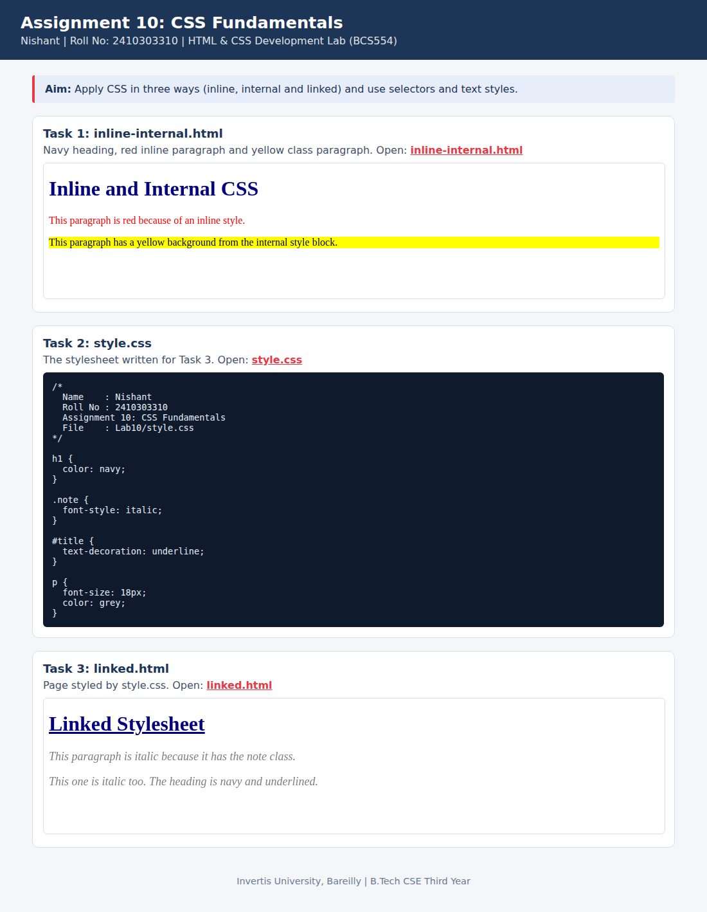

<!--
  Name    : Nishant
  Roll No : 2410303310
  Assignment 10: CSS Fundamentals
-->
# Lab 10: CSS Fundamentals

**Name:** Nishant  
**Roll No:** 2410303310  
**Course:** HTML & CSS Development Lab (BCS554), B.Tech CSE Third Year, Invertis University, Bareilly

## Aim

Apply CSS in three ways (inline, internal and linked) and use selectors and text styles.

## Tasks

1. **Task 1: inline-internal.html**: Navy heading, red inline paragraph and yellow class paragraph.
2. **Task 2: style.css**: The stylesheet written for Task 3.
3. **Task 3: linked.html**: Page styled by style.css.

## Concepts used

- Inline, internal and linked CSS
- Element, class (.note) and id (#title) selectors
- color, font-size, font-style, text-decoration

## Files

- `index.html`
- `inline-internal.html`
- `linked.html`
- `style.css`
- `images/screenshot.png`

## How to run

Open `index.html` in any browser (double-click it). It shows every task page in a preview and links to each file.

## Screenshot

Note: `index.html` in this lab uses its own internal styles so that it does not clash with `style.css`, which is the Task 2 stylesheet.
