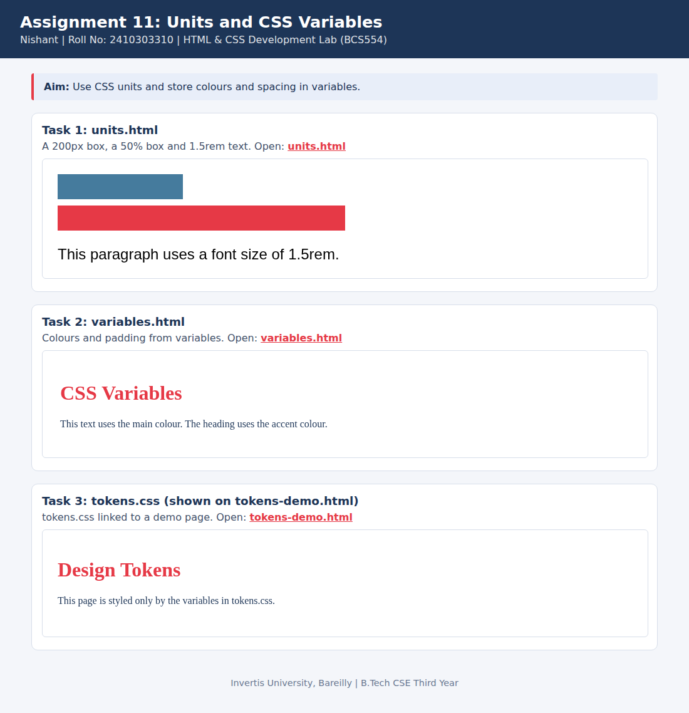

<!--
  Name    : Nishant
  Roll No : 2410303310
  Assignment 11: Units and CSS Variables
-->
# Lab 11: Units and CSS Variables

**Name:** Nishant  
**Roll No:** 2410303310  
**Course:** HTML & CSS Development Lab (BCS554), B.Tech CSE Third Year, Invertis University, Bareilly

## Aim

Use CSS units and store colours and spacing in variables.

## Tasks

1. **Task 1: units.html**: A 200px box, a 50% box and 1.5rem text.
2. **Task 2: variables.html**: Colours and padding from variables.
3. **Task 3: tokens.css (shown on tokens-demo.html)**: tokens.css linked to a demo page.

## Concepts used

- px, % and rem units
- Custom properties with :root and var()
- A reusable tokens.css file

## Files

- `index.html`
- `style.css`
- `tokens-demo.html`
- `tokens.css`
- `units.html`
- `variables.html`
- `images/screenshot.png`

## How to run

Open `index.html` in any browser (double-click it). It shows every task page in a preview and links to each file.

## Screenshot

