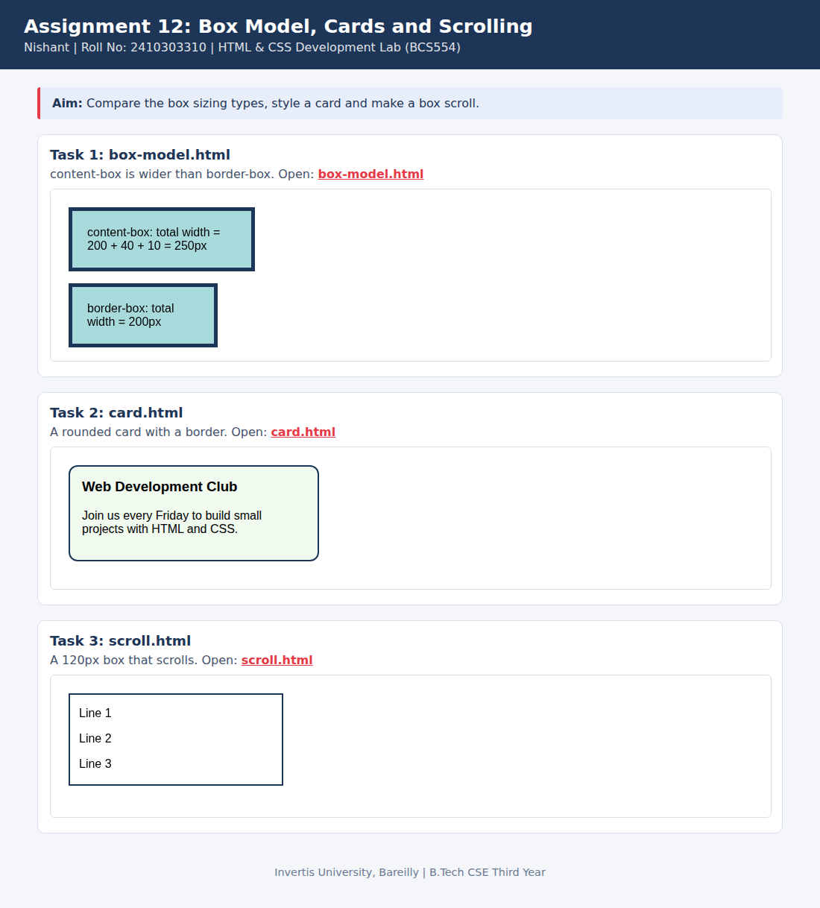

<!--
  Name    : Nishant
  Roll No : 2410303310
  Assignment 12: Box Model, Cards and Scrolling
-->
# Lab 12: Box Model, Cards and Scrolling

**Name:** Nishant  
**Roll No:** 2410303310  
**Course:** HTML & CSS Development Lab (BCS554), B.Tech CSE Third Year, Invertis University, Bareilly

## Aim

Compare the box sizing types, style a card and make a box scroll.

## Tasks

1. **Task 1: box-model.html**: content-box is wider than border-box.
2. **Task 2: card.html**: A rounded card with a border.
3. **Task 3: scroll.html**: A 120px box that scrolls.

## Concepts used

- content-box vs border-box
- border, border-radius and padding on a card
- Fixed height with overflow: auto

## Files

- `box-model.html`
- `card.html`
- `index.html`
- `scroll.html`
- `style.css`
- `images/screenshot.png`

## How to run

Open `index.html` in any browser (double-click it). It shows every task page in a preview and links to each file.

## Screenshot

