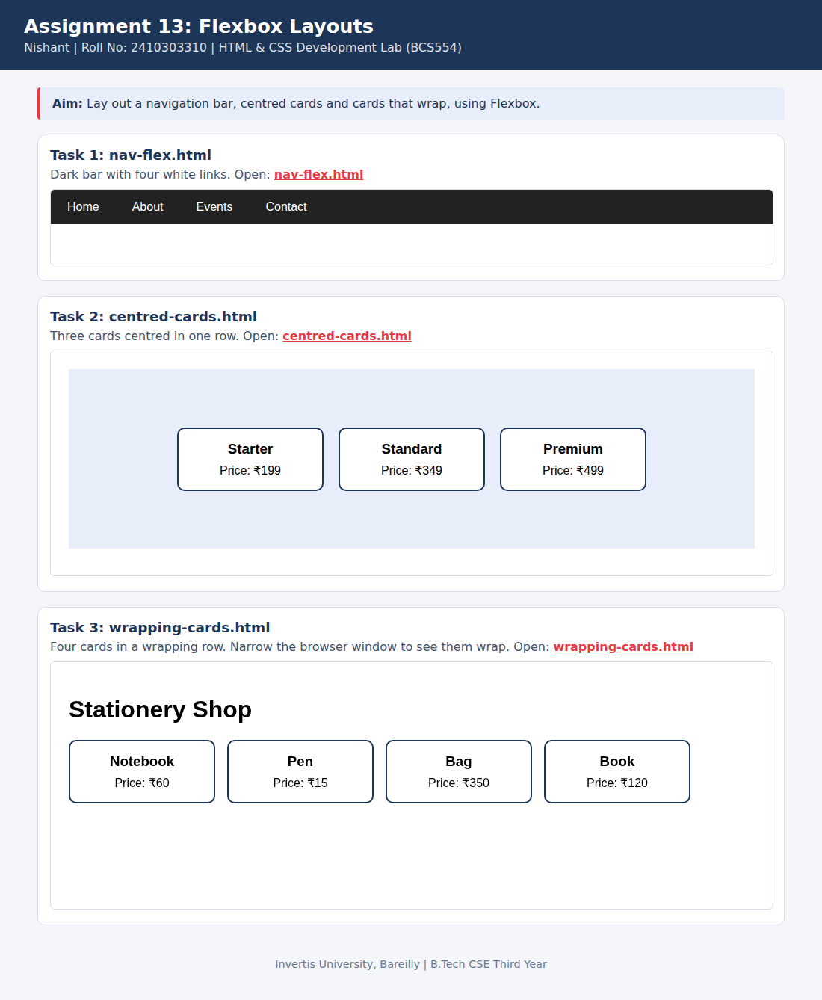

<!--
  Name    : Nishant
  Roll No : 2410303310
  Assignment 13: Flexbox Layouts
-->
# Lab 13: Flexbox Layouts

**Name:** Nishant  
**Roll No:** 2410303310  
**Course:** HTML & CSS Development Lab (BCS554), B.Tech CSE Third Year, Invertis University, Bareilly

## Aim

Lay out a navigation bar, centred cards and cards that wrap, using Flexbox.

## Tasks

1. **Task 1: nav-flex.html**: Dark bar with four white links.
2. **Task 2: centred-cards.html**: Three cards centred in one row.
3. **Task 3: wrapping-cards.html**: Four cards in a wrapping row. Narrow the browser window to see them wrap.

## Concepts used

- display: flex on a container
- justify-content and align-items
- flex-wrap and gap

## Files

- `centred-cards.html`
- `index.html`
- `nav-flex.html`
- `style.css`
- `wrapping-cards.html`
- `images/screenshot.png`

## How to run

Open `index.html` in any browser (double-click it). It shows every task page in a preview and links to each file.

## Screenshot

