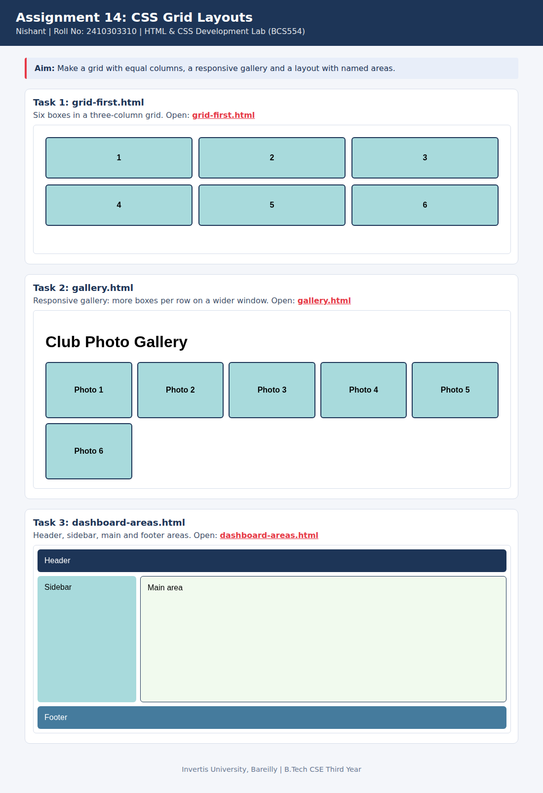

<!--
  Name    : Nishant
  Roll No : 2410303310
  Assignment 14: CSS Grid Layouts
-->
# Lab 14: CSS Grid Layouts

**Name:** Nishant  
**Roll No:** 2410303310  
**Course:** HTML & CSS Development Lab (BCS554), B.Tech CSE Third Year, Invertis University, Bareilly

## Aim

Make a grid with equal columns, a responsive gallery and a layout with named areas.

## Tasks

1. **Task 1: grid-first.html**: Six boxes in a three-column grid.
2. **Task 2: gallery.html**: Responsive gallery: more boxes per row on a wider window.
3. **Task 3: dashboard-areas.html**: Header, sidebar, main and footer areas.

## Concepts used

- grid-template-columns with fr units and gap
- repeat(auto-fill, minmax(150px, 1fr))
- grid-template-areas and grid-area

## Files

- `dashboard-areas.html`
- `gallery.html`
- `grid-first.html`
- `index.html`
- `style.css`
- `images/screenshot.png`

## How to run

Open `index.html` in any browser (double-click it). It shows every task page in a preview and links to each file.

## Screenshot

