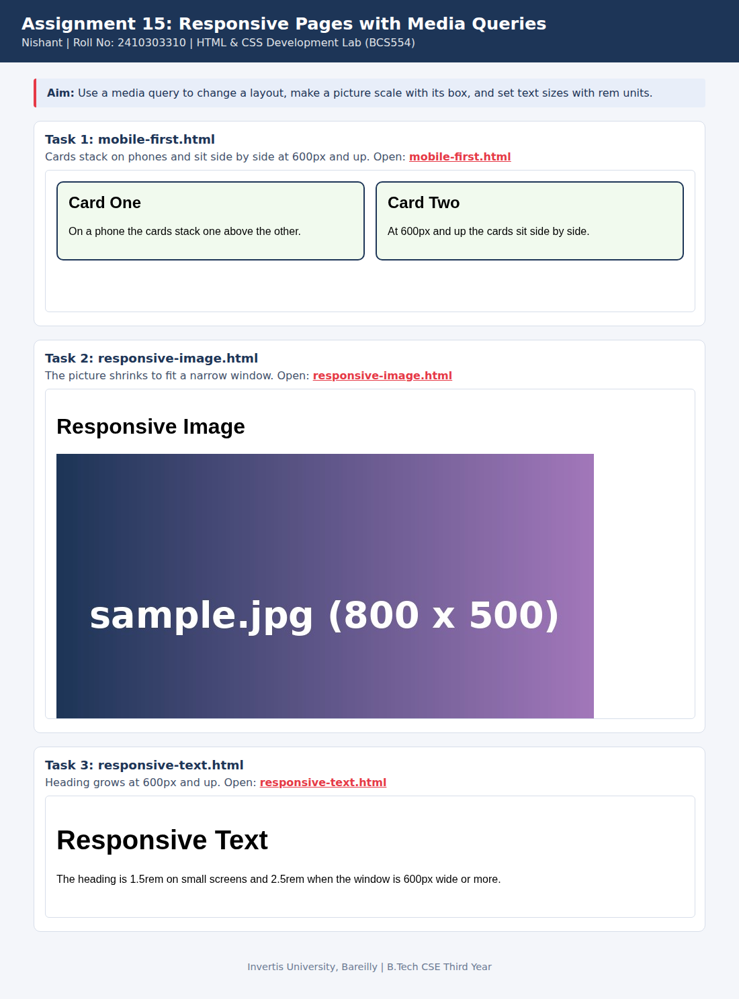

<!--
  Name    : Nishant
  Roll No : 2410303310
  Assignment 15: Responsive Pages with Media Queries
-->
# Lab 15: Responsive Pages with Media Queries

**Name:** Nishant  
**Roll No:** 2410303310  
**Course:** HTML & CSS Development Lab (BCS554), B.Tech CSE Third Year, Invertis University, Bareilly

## Aim

Use a media query to change a layout, make a picture scale with its box, and set text sizes with rem units.

## Tasks

1. **Task 1: mobile-first.html**: Cards stack on phones and sit side by side at 600px and up.
2. **Task 2: responsive-image.html**: The picture shrinks to fit a narrow window.
3. **Task 3: responsive-text.html**: Heading grows at 600px and up.

## Concepts used

- Viewport meta tag and mobile-first CSS
- @media (min-width: 600px)
- max-width: 100% with height: auto, and rem units

## Files

- `index.html`
- `mobile-first.html`
- `responsive-image.html`
- `responsive-text.html`
- `style.css`
- `images/screenshot.png`

## How to run

Open `index.html` in any browser (double-click it). It shows every task page in a preview and links to each file.

## Screenshot

## Image file name

The picture is `images/sample.jpg` (a placeholder). Replace it with the file your instructor gives you and update the `src` in `responsive-image.html`.
