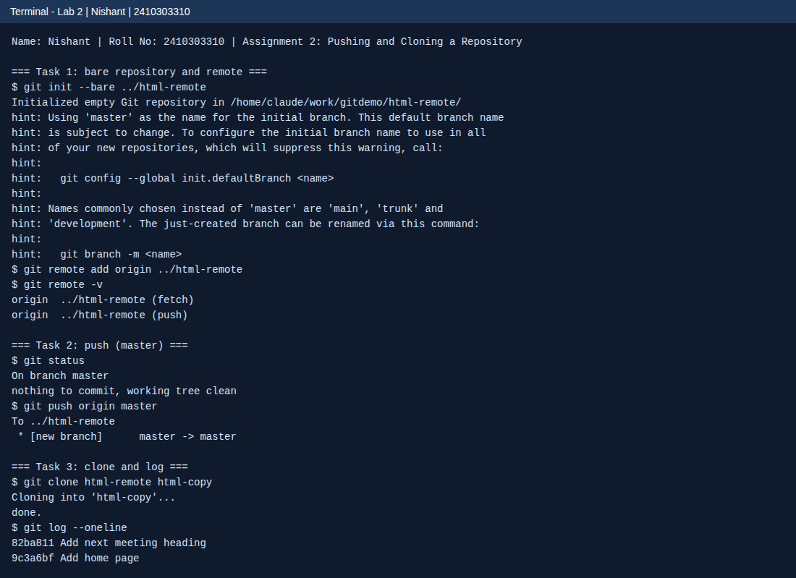

<!--
  Name    : Nishant
  Roll No : 2410303310
  Assignment 2: Pushing and Cloning a Repository
-->
# Lab 2: Pushing and Cloning a Repository

**Name:** Nishant  
**Roll No:** 2410303310  
**Course:** HTML & CSS Development Lab (BCS554), B.Tech CSE Third Year, Invertis University, Bareilly

## Aim

Send your commits to a second repository on your computer and make a copy of it with clone.

## Tasks

1. **Tasks 1-3: Terminal output**: Commands run and the output they printed (real output).

## Concepts used

- git init --bare makes a repository with no working files
- git remote add origin links a remote
- git push origin master uploads commits (this machine's branch was master)
- git clone copies a repository with its history

## Files

- `index.html`
- `style.css`
- `terminal-output.txt`
- `images/screenshot.png`

## How to run

Open `terminal-output.txt` to read the command output. Run the commands in a terminal to repeat the lab.

## Screenshot



## Terminal output

### Task 1: bare repository and remote
```
$ git init --bare ../html-remote
Initialized empty Git repository in /home/claude/work/gitdemo/html-remote/
hint: Using 'master' as the name for the initial branch. This default branch name
hint: is subject to change. To configure the initial branch name to use in all
hint: of your new repositories, which will suppress this warning, call:
hint: 
hint: 	git config --global init.defaultBranch <name>
hint: 
hint: Names commonly chosen instead of 'master' are 'main', 'trunk' and
hint: 'development'. The just-created branch can be renamed via this command:
hint: 
hint: 	git branch -m <name>
$ git remote add origin ../html-remote
$ git remote -v
origin	../html-remote (fetch)
origin	../html-remote (push)
```

### Task 2: push
```
$ git status
On branch master
nothing to commit, working tree clean
$ git push origin master
To ../html-remote
 * [new branch]      master -> master
```

### Task 3: clone and log
```
$ git clone html-remote html-copy
Cloning into 'html-copy'...
done.
$ git log --oneline
82ba811 Add next meeting heading
9c3a6bf Add home page
```

Branch note: `git status` showed `On branch master`, so `git push origin master` was used, as the assignment instructs.
