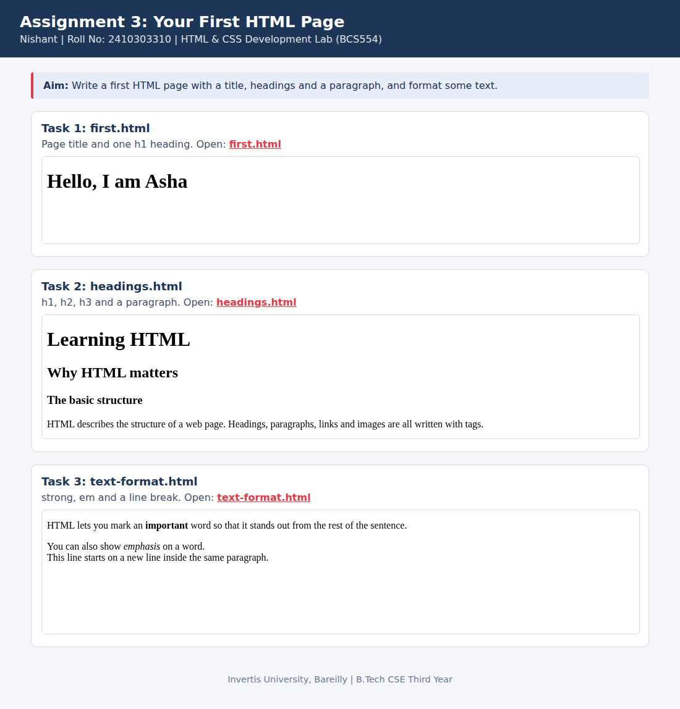

<!--
  Name    : Nishant
  Roll No : 2410303310
  Assignment 3: Your First HTML Page
-->
# Lab 3: Your First HTML Page

**Name:** Nishant  
**Roll No:** 2410303310  
**Course:** HTML & CSS Development Lab (BCS554), B.Tech CSE Third Year, Invertis University, Bareilly

## Aim

Write a first HTML page with a title, headings and a paragraph, and format some text.

## Tasks

1. **Task 1: first.html**: Page title and one h1 heading.
2. **Task 2: headings.html**: h1, h2, h3 and a paragraph.
3. **Task 3: text-format.html**: strong, em and a line break.

## Concepts used

- Document structure: doctype, html, head, body
- Headings h1 to h3 and paragraphs
- strong, em and br

## Files

- `first.html`
- `headings.html`
- `index.html`
- `style.css`
- `text-format.html`
- `images/screenshot.png`

## How to run

Open `index.html` in any browser (double-click it). It shows every task page in a preview and links to each file.

## Screenshot

