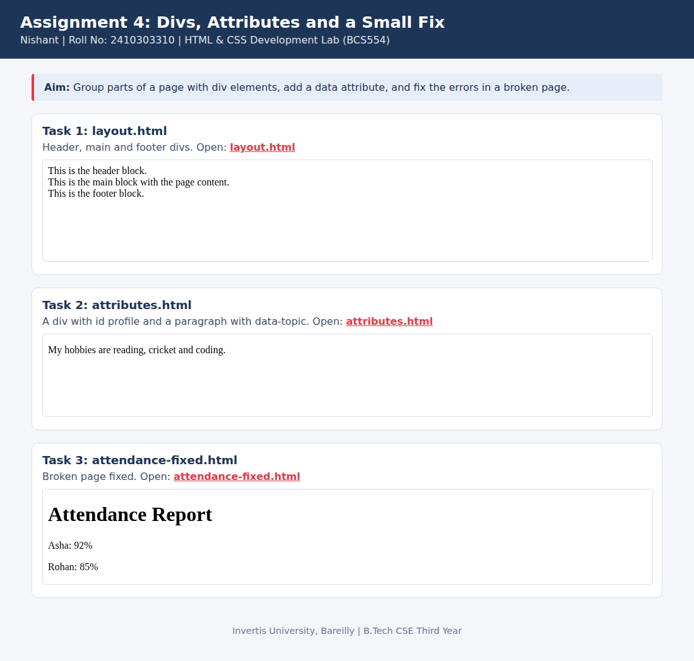

<!--
  Name    : Nishant
  Roll No : 2410303310
  Assignment 4: Divs, Attributes and a Small Fix
-->
# Lab 4: Divs, Attributes and a Small Fix

**Name:** Nishant  
**Roll No:** 2410303310  
**Course:** HTML & CSS Development Lab (BCS554), B.Tech CSE Third Year, Invertis University, Bareilly

## Aim

Group parts of a page with div elements, add a data attribute, and fix the errors in a broken page.

## Tasks

1. **Task 1: layout.html**: Header, main and footer divs.
2. **Task 2: attributes.html**: A div with id profile and a paragraph with data-topic.
3. **Task 3: attendance-fixed.html**: Broken page fixed.

## Concepts used

- div blocks with class names
- id and data-* attributes
- Closing every tag correctly

## Files

- `attendance-fixed.html`
- `attributes.html`
- `index.html`
- `layout.html`
- `style.css`
- `images/screenshot.png`

## How to run

Open `index.html` in any browser (double-click it). It shows every task page in a preview and links to each file.

## Screenshot

## Errors fixed in Task 3

1. `<h1>Attendance Report` was never closed. Added `</h1>`.
2. `
Asha: 92%
` ended with an opening tag. Changed it to `
`.
