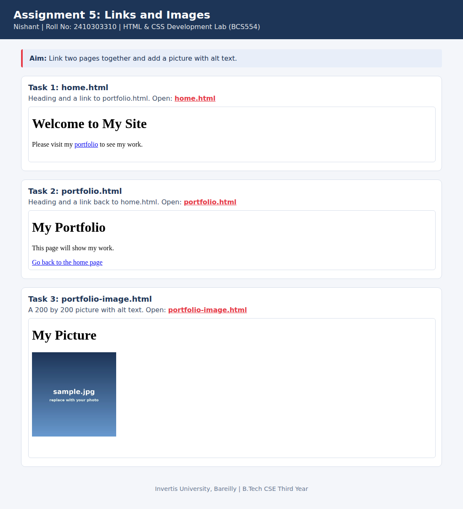

<!--
  Name    : Nishant
  Roll No : 2410303310
  Assignment 5: Links and Images
-->
# Lab 5: Links and Images

**Name:** Nishant  
**Roll No:** 2410303310  
**Course:** HTML & CSS Development Lab (BCS554), B.Tech CSE Third Year, Invertis University, Bareilly

## Aim

Link two pages together and add a picture with alt text.

## Tasks

1. **Task 1: home.html**: Heading and a link to portfolio.html.
2. **Task 2: portfolio.html**: Heading and a link back to home.html.
3. **Task 3: portfolio-image.html**: A 200 by 200 picture with alt text.

## Concepts used

- The a element with href
- Links between pages in the same folder
- img with src, width, height and alt

## Files

- `home.html`
- `index.html`
- `portfolio-image.html`
- `portfolio.html`
- `style.css`
- `images/screenshot.png`

## How to run

Open `index.html` in any browser (double-click it). It shows every task page in a preview and links to each file.

## Screenshot

## Image file name

The picture is `images/sample.jpg` (a placeholder). Your instructor will give the real file name. Put that file in the `images` folder and change the `src` in `portfolio-image.html`.
