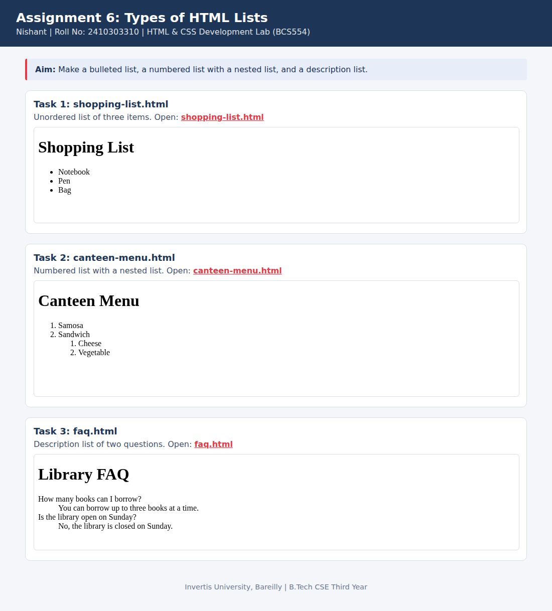

<!--
  Name    : Nishant
  Roll No : 2410303310
  Assignment 6: Types of HTML Lists
-->
# Lab 6: Types of HTML Lists

**Name:** Nishant  
**Roll No:** 2410303310  
**Course:** HTML & CSS Development Lab (BCS554), B.Tech CSE Third Year, Invertis University, Bareilly

## Aim

Make a bulleted list, a numbered list with a nested list, and a description list.

## Tasks

1. **Task 1: shopping-list.html**: Unordered list of three items.
2. **Task 2: canteen-menu.html**: Numbered list with a nested list.
3. **Task 3: faq.html**: Description list of two questions.

## Concepts used

- ul and ol with li
- Nesting a list inside an li
- Description lists: dl, dt, dd

## Files

- `canteen-menu.html`
- `faq.html`
- `index.html`
- `shopping-list.html`
- `style.css`
- `images/screenshot.png`

## How to run

Open `index.html` in any browser (double-click it). It shows every task page in a preview and links to each file.

## Screenshot

