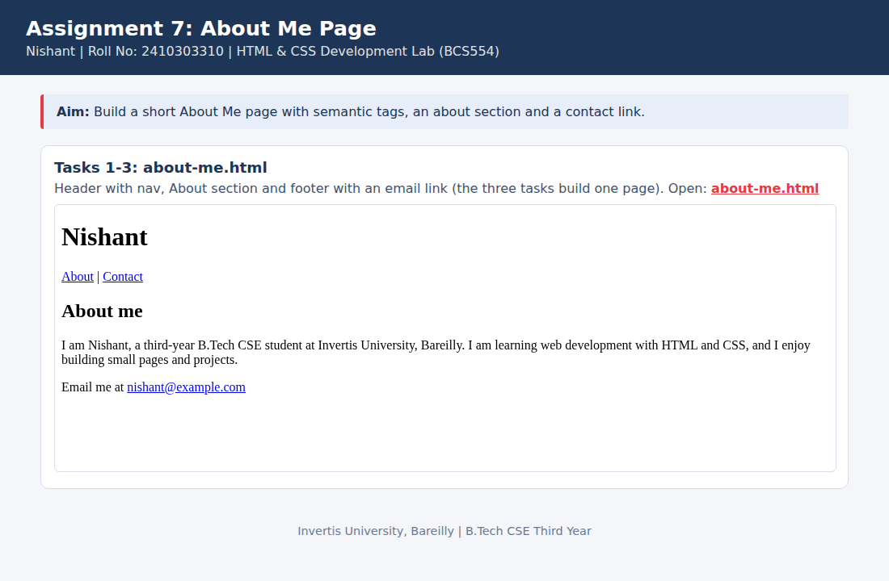

<!--
  Name    : Nishant
  Roll No : 2410303310
  Assignment 7: About Me Page
-->
# Lab 7: About Me Page

**Name:** Nishant  
**Roll No:** 2410303310  
**Course:** HTML & CSS Development Lab (BCS554), B.Tech CSE Third Year, Invertis University, Bareilly

## Aim

Build a short About Me page with semantic tags, an about section and a contact link.

## Tasks

1. **Tasks 1-3: about-me.html**: Header with nav, About section and footer with an email link (the three tasks build one page).

## Concepts used

- Semantic tags: header, nav, main, section, footer
- In-page links with #id
- mailto: links

## Files

- `about-me.html`
- `index.html`
- `style.css`
- `images/screenshot.png`

## How to run

Open `index.html` in any browser (double-click it). It shows every task page in a preview and links to each file.

## Screenshot

## Note

The three tasks build on one file, so `about-me.html` is the final version. The email `nishant@example.com` is a placeholder; replace it with your own.
