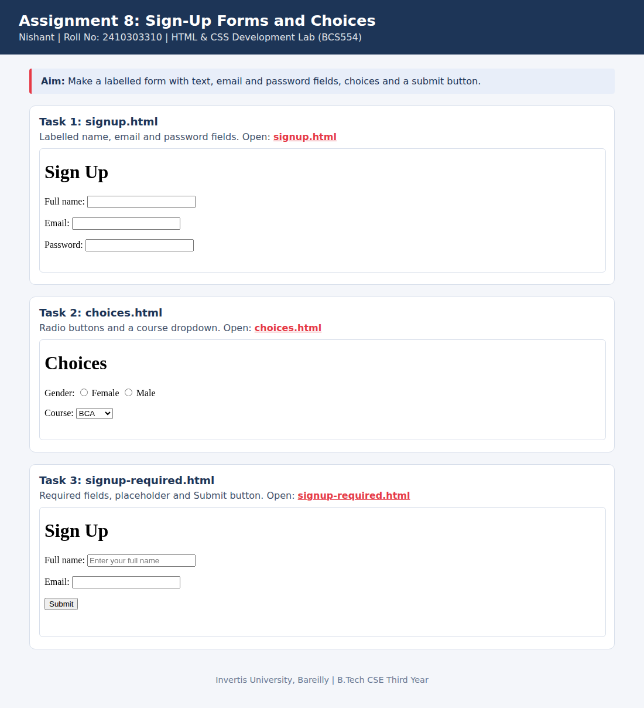

<!--
  Name    : Nishant
  Roll No : 2410303310
  Assignment 8: Sign-Up Forms and Choices
-->
# Lab 8: Sign-Up Forms and Choices

**Name:** Nishant  
**Roll No:** 2410303310  
**Course:** HTML & CSS Development Lab (BCS554), B.Tech CSE Third Year, Invertis University, Bareilly

## Aim

Make a labelled form with text, email and password fields, choices and a submit button.

## Tasks

1. **Task 1: signup.html**: Labelled name, email and password fields.
2. **Task 2: choices.html**: Radio buttons and a course dropdown.
3. **Task 3: signup-required.html**: Required fields, placeholder and Submit button.

## Concepts used

- form with method and action
- label for= linked to input id=
- radio, select, required and placeholder

## Files

- `choices.html`
- `index.html`
- `signup-required.html`
- `signup.html`
- `style.css`
- `images/screenshot.png`

## How to run

Open `index.html` in any browser (double-click it). It shows every task page in a preview and links to each file.

## Screenshot

