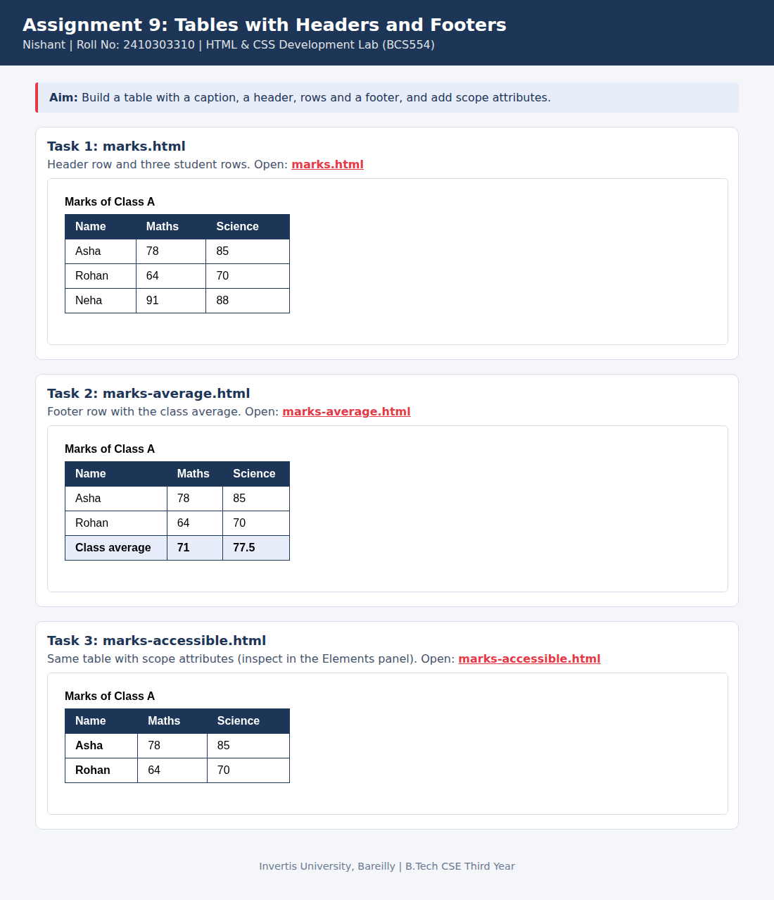

<!--
  Name    : Nishant
  Roll No : 2410303310
  Assignment 9: Tables with Headers and Footers
-->
# Lab 9: Tables with Headers and Footers

**Name:** Nishant  
**Roll No:** 2410303310  
**Course:** HTML & CSS Development Lab (BCS554), B.Tech CSE Third Year, Invertis University, Bareilly

## Aim

Build a table with a caption, a header, rows and a footer, and add scope attributes.

## Tasks

1. **Task 1: marks.html**: Header row and three student rows.
2. **Task 2: marks-average.html**: Footer row with the class average.
3. **Task 3: marks-accessible.html**: Same table with scope attributes (inspect in the Elements panel).

## Concepts used

- caption, thead, tbody, tfoot
- Class average: Maths (78+64)/2 = 71, Science (85+70)/2 = 77.5
- scope="col" and scope="row" for accessibility

## Files

- `index.html`
- `marks-accessible.html`
- `marks-average.html`
- `marks.html`
- `style.css`
- `images/screenshot.png`

## How to run

Open `index.html` in any browser (double-click it). It shows every task page in a preview and links to each file.

## Screenshot

